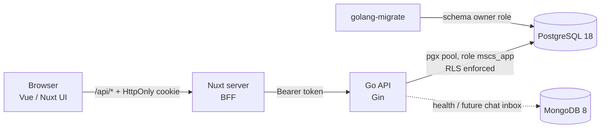

# MSCS — Multi-tenant Social-Commerce SaaS

[](https://github.com/AriyaChakot/Minis-social-commerce-SaaS/actions/workflows/ci.yml)

Order management for small online shops that sell through **LINE, Facebook and Instagram chats**.
Each shop (tenant) manages its catalog and records the orders its customers place in chat:
stock is reserved the moment an order is created, and every order moves through a clear
lifecycle — *pending → paid → shipped → completed* (or *cancelled*, which returns the stock).

Built as a portfolio project to practice production-grade backend and frontend engineering:
multi-tenant data isolation, concurrency-safe inventory, secure session handling, and tests that
run against a real database.

| Orders | New order |
|---|---|
|  |  |
| **Order detail** | **Products** |
|  |  |

*The merchant UI is in Thai, the language of its target users.*

---

## Features

- **Accounts & shops** — sign up creates a user, their first shop and the owner membership in one transaction.
- **Roles per shop** — `owner`, `admin`, `staff`. Staff can process orders but cannot edit the catalog or cancel orders.
- **Products** — create, edit, search, keyset pagination, soft delete ("stop selling") so past orders stay intact.
- **Orders** — multi-item orders with stock reservation, per-shop order numbers (`#1001`, `#1002`…), status
  state machine with timestamps, cancellation that returns stock.
- **Merchant admin web app** — server-rendered Nuxt app with form validation, toasts, confirmation dialogs.

## Architecture



The Go API is a **modular monolith**: one deployable, organised by business domain
(`auth`, `tenant`, `user`, `product`, `order`), each with its own model, repository and service.
Handlers translate HTTP; services hold the business rules; repositories hold the SQL.

## Tech stack

| Area | Technology |
|---|---|
| API | Go 1.26, Gin, pgx v5, golang-migrate |
| Database | PostgreSQL 18 (UUIDv7, Row-Level Security), MongoDB 8 |
| Frontend | Nuxt 4, Vue 3, TypeScript, Nuxt UI 4 (Tailwind CSS 4), Zod |
| Tooling | Docker Compose, pnpm workspaces, GitHub Actions |

## Engineering highlights

**Tenant isolation enforced by the database (Row-Level Security).**
All shops share tables (`tenant_id` column). Every tenant-owned table has a Postgres RLS policy, and the
API connects as a restricted role (`mscs_app`, no `BYPASSRLS`) — separate from the role that runs migrations.
Each request sets the tenant with `set_config('app.tenant_id', …, true)`, which is *transaction-local*, so the
setting can never leak to the next request that reuses a pooled connection. Queries still filter on
`tenant_id` explicitly; RLS is the safety net. Composite foreign keys (`(tenant_id, product_id)`) make it
impossible, even for a superuser, to put another shop's product in an order.

**No overselling under concurrency.**
Order creation locks the product rows (`SELECT … FOR UPDATE`, always in id order to avoid deadlocks), checks
stock, copies a price snapshot into the order lines and decrements stock in a single transaction.
A test fires 20 concurrent orders at a product with 5 in stock and asserts exactly 5 succeed with unique
order numbers; another fires 10 concurrent cancellations and asserts the stock is returned once.
CI runs them with Go's race detector.

**Money as integers.** Prices are stored as `bigint` satang (1 THB = 100 satang), never floats; the frontend
parses typed amounts like `"1,299.50"` as text, so no floating-point rounding can occur. `CHECK` constraints make
the database reject an order whose total does not add up.

**Session auth without exposing tokens to JavaScript (BFF).**
Passwords are hashed with Argon2id. Sessions are random 128-bit tokens stored as SHA-256 hashes, so they can be
revoked instantly (unlike stateless JWTs). The browser never sees the token: the Nuxt server keeps it in an
`HttpOnly`, `SameSite=Lax` cookie and proxies `/api/*` to the Go API, adding a `Sec-Fetch-Site`/`Origin` CSRF
check for state-changing requests. Login responses are identical — and take the same time — for unknown
emails and wrong passwords.

**Other details** — keyset pagination on time-ordered UUIDv7 ids, a status state machine shared (mirrored) by API
and UI, uniform JSON errors (`{"error": {"code", "message", "details"}}`), `404` instead of `403` for shops you are
not a member of, graceful shutdown, liveness vs readiness probes, request body size limits.

## Getting started

**Prerequisites:** Docker Desktop, Node.js ≥ 22.19, pnpm 10. Go is *not* required locally (it runs in Docker).

```bash
# 1. Configuration: copy the example and change every password
cp .env.example .env

# 2. Start PostgreSQL, MongoDB and the Go API (http://localhost:8080)
docker compose up -d --build

# 3. Create the database schema
docker compose run --rm migrate up

# 4. Start the merchant web app (http://localhost:3000)
cd frontend
pnpm install
pnpm dev:merchant
```

Open http://localhost:3000, sign up, add a few products and create an order.

## Tests

The integration tests need the database from `docker compose` and connect as the restricted role,
so Row-Level Security is part of what they test. Without `DATABASE_URL` they are skipped.

```powershell
# Windows (PowerShell) helper: runs Go inside Docker
.\scripts\go.ps1 test ./...                    # unit tests only
.\scripts\go.ps1 --db test -race ./...         # + integration tests against Postgres
```

```bash
# Any OS, plain Docker (replace <APP_DB_PASSWORD> with the value from .env)
docker run --rm --network mscs_default -v "$PWD/backend:/src" -w /src \
  -e DATABASE_URL="postgres://mscs_app:<APP_DB_PASSWORD>@postgres:5432/mscs?sslmode=disable" \
  golang:1.26 go test -race ./...
```

```bash
cd frontend && pnpm typecheck
```

CI ([`.github/workflows/ci.yml`](.github/workflows/ci.yml)) runs gofmt, `go vet`, the full test suite with
`-race` against PostgreSQL 18, the Docker image build, and the frontend typecheck and production build.

## API overview

All routes are under `/api/v1`. Shop routes require membership of `:tenantID`; catalog changes require
`owner` or `admin`.

| Method | Path | Description |
|---|---|---|
| `POST` | `/auth/register` | Create account + first shop, start a session |
| `POST` | `/auth/login` · `/auth/logout` | Start / end a session |
| `GET` | `/me` | Current user and their shop memberships |
| `GET` | `/tenants/:tenantID` | Shop details and your role |
| `GET` `POST` | `/tenants/:tenantID/products` | List (search, status, cursor) / create |
| `GET` `PATCH` `DELETE` | `/tenants/:tenantID/products/:productID` | Read / partial update / stop selling |
| `GET` `POST` | `/tenants/:tenantID/orders` | List (status, search, cursor) / create |
| `GET` | `/tenants/:tenantID/orders/:orderID` | Order with its lines |
| `POST` | `/tenants/:tenantID/orders/:orderID/status` | Move along the state machine |

`GET /healthz` (liveness) and `GET /readyz` (readiness: pings PostgreSQL and MongoDB).

## Project structure

```
backend/
  cmd/api/              entry point: config, DB connections, graceful shutdown
  internal/
    auth/               passwords (Argon2id), sessions, auth use cases
    tenant/ user/       shops, memberships, users
    product/ order/     catalog, stock, orders and their state machine
    database/           pool, RLS-scoped transactions (InTx), shared helpers
    handler/ server/    HTTP handlers, middleware, routes
  migrations/           SQL migrations (golang-migrate)
frontend/               pnpm workspace
  apps/merchant/        Nuxt merchant admin (app/ = UI, server/ = BFF)
  packages/shared/      API types and helpers shared by all frontends
docker/                 Postgres init script (restricted app role)
scripts/                developer helpers
```

## Roadmap

- [ ] Customer storefront and checkout (SvelteKit)
- [ ] Chat inbox for LINE / Facebook messages (MongoDB, webhooks)
- [ ] Background worker: expire unpaid orders, clean up sessions (leader election via Postgres advisory locks)
- [ ] Platform admin console (React)
- [ ] Staff invitations, rate limiting on login

---

Built by **Ariya Chakot**.
