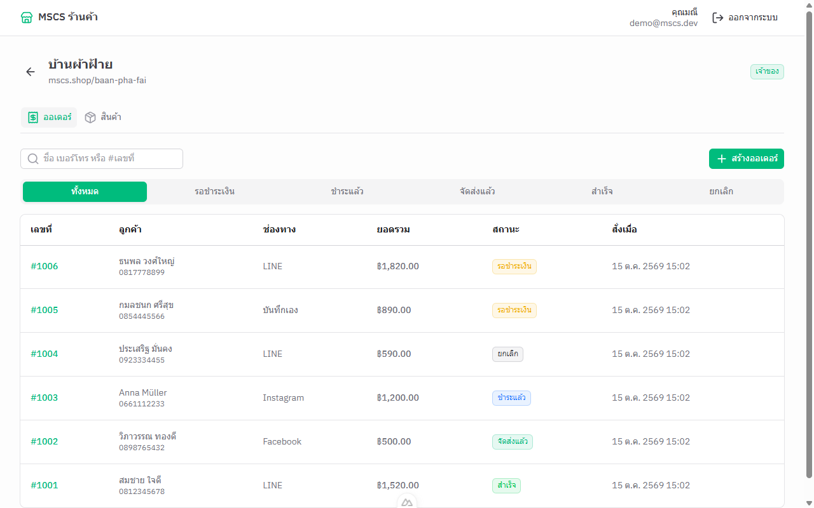
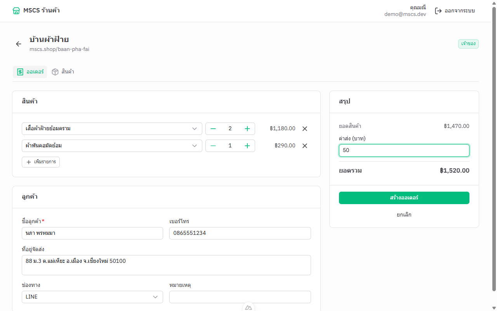
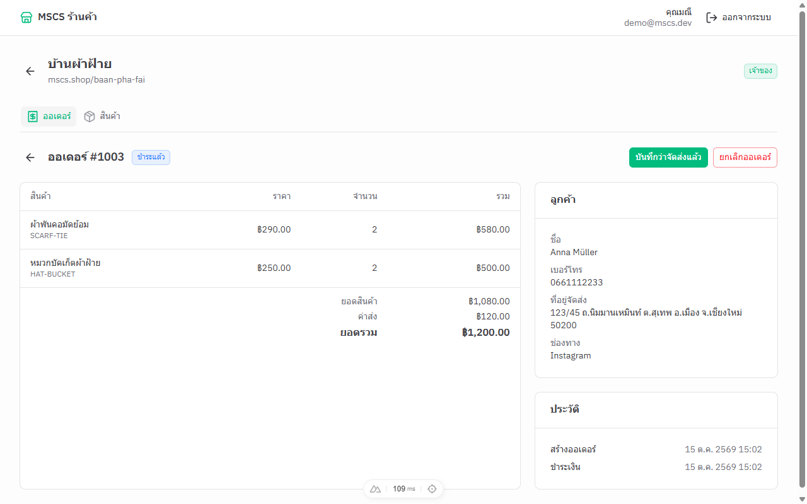
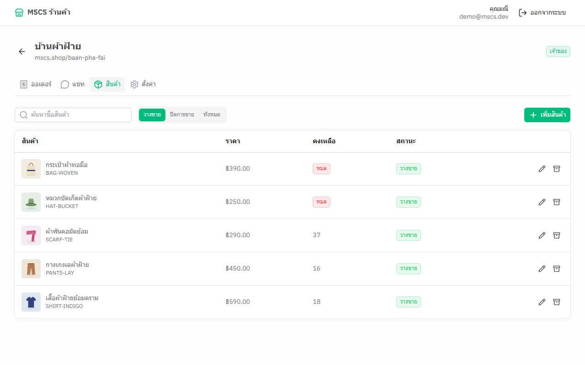
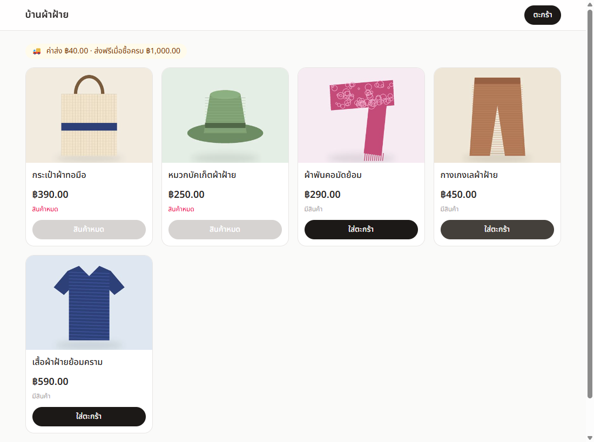
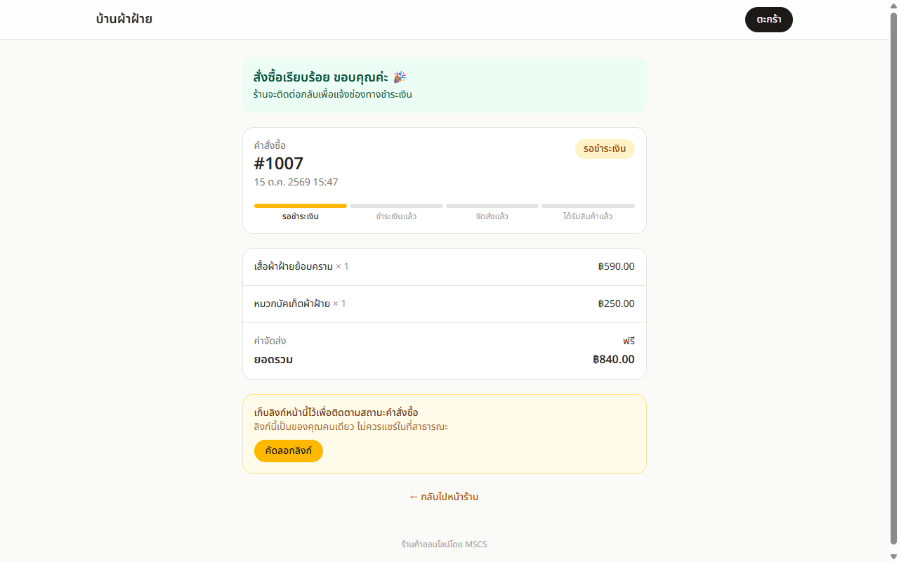
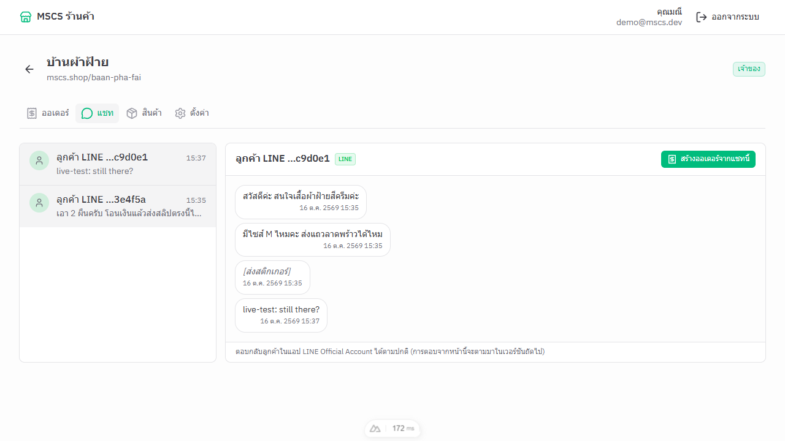
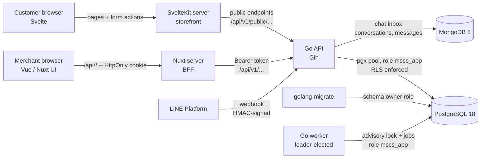

# MSCS — Multi-tenant Social-Commerce SaaS

[](https://github.com/AriyaChakot/Minis-social-commerce-SaaS/actions/workflows/ci.yml)

Order management for small online shops that sell through **LINE, Facebook and Instagram chats**.
Each shop (tenant) manages its catalog and records the orders its customers place in chat — or
shares its own **online storefront link**, where customers order without an account and follow
their order through a private tracking link. Stock is reserved the moment an order is created, and
every order moves through a clear lifecycle — *pending → paid → shipped → completed* (or
*cancelled*, which returns the stock).

Built as a portfolio project to practice production-grade backend and frontend engineering:
multi-tenant data isolation, concurrency-safe inventory, secure session handling, and tests that
run against a real database.

| Orders | New order |
|---|---|
|  |  |
| **Order detail** | **Products** |
|  |  |
| **Storefront (customer)** | **Order tracking (customer)** |
|  |  |
| **Chat inbox (LINE)** | |
|  | |

*The UI is in Thai, the language of its target users.*

---

## Features

- **Accounts & shops** — sign up creates a user, their first shop and the owner membership in one transaction.
- **Roles per shop** — `owner`, `admin`, `staff`. Staff can process orders but cannot edit the catalog or cancel orders.
- **Products** — create, edit, search, keyset pagination, soft delete ("stop selling") so past orders stay intact.
- **Orders** — multi-item orders with stock reservation, per-shop order numbers (`#1001`, `#1002`…), status
  state machine with timestamps, cancellation that returns stock.
- **Merchant admin web app** — server-rendered Nuxt app with form validation, toasts, confirmation dialogs.
- **Customer storefront** — SvelteKit app at `/s/<shop-slug>`: product grid, cart, guest checkout, and a private
  tracking page that shows the order's progress as the merchant updates it.
- **Chat inbox** — connect the shop's LINE Official Account; customers' messages arrive by webhook and appear in
  one inbox per shop (unread counts, live refresh), and a chat becomes an order in one click.
- **Background worker** — cancels storefront orders left unpaid past a payment window (the stock goes back on sale;
  the customer sees the deadline and the reason), and deletes expired sessions. Runs safely with several replicas.

## Architecture



Browsers never call the Go API directly: each frontend has its own server (Nuxt / SvelteKit) that does.

The backend is a **modular monolith**: one code base and one Docker image with two programs (`cmd/api`,
`cmd/worker`), organised by business domain (`auth`, `tenant`, `user`, `product`, `order`), each with its own
model, repository and service.
Handlers translate HTTP; services hold the business rules; repositories hold the SQL.

## Tech stack

| Area | Technology |
|---|---|
| API | Go 1.26, Gin, pgx v5, golang-migrate |
| Database | PostgreSQL 18 (UUIDv7, Row-Level Security), MongoDB 8 |
| Merchant app | Nuxt 4, Vue 3, TypeScript, Nuxt UI 4 (Tailwind CSS 4), Zod |
| Storefront | SvelteKit 3, Svelte 5 (runes), TypeScript 6, Tailwind CSS 4 |
| Tooling | Docker Compose, pnpm workspaces, GitHub Actions |

## Engineering highlights

**Tenant isolation enforced by the database (Row-Level Security).**
All shops share tables (`tenant_id` column). Every tenant-owned table has a Postgres RLS policy, and the
API connects as a restricted role (`mscs_app`, no `BYPASSRLS`) — separate from the role that runs migrations.
Each request sets the tenant with `set_config('app.tenant_id', …, true)`, which is *transaction-local*, so the
setting can never leak to the next request that reuses a pooled connection. Queries still filter on
`tenant_id` explicitly; RLS is the safety net. Composite foreign keys (`(tenant_id, product_id)`) make it
impossible, even for a superuser, to put another shop's product in an order.

**No overselling under concurrency.**
Order creation locks the product rows (`SELECT … FOR UPDATE`, always in id order to avoid deadlocks), checks
stock, copies a price snapshot into the order lines and decrements stock in a single transaction.
A test fires 20 concurrent orders at a product with 5 in stock and asserts exactly 5 succeed with unique
order numbers; another fires 10 concurrent cancellations and asserts the stock is returned once.
CI runs them with Go's race detector.

**Money as integers.** Prices are stored as `bigint` satang (1 THB = 100 satang), never floats; the frontend
parses typed amounts like `"1,299.50"` as text, so no floating-point rounding can occur. `CHECK` constraints make
the database reject an order whose total does not add up.

**Session auth without exposing tokens to JavaScript (BFF).**
Passwords are hashed with Argon2id. Sessions are random 128-bit tokens stored as SHA-256 hashes, so they can be
revoked instantly (unlike stateless JWTs). The browser never sees the token: the Nuxt server keeps it in an
`HttpOnly`, `SameSite=Lax` cookie and proxies `/api/*` to the Go API, adding a `Sec-Fetch-Site`/`Origin` CSRF
check for state-changing requests. Login responses are identical — and take the same time — for unknown
emails and wrong passwords.

**Guest checkout without accounts.** A storefront order returns a random tracking token once; only its SHA-256
hash is stored, so the link (`/s/<shop>/orders/<token>`) is the customer's receipt and nobody else's. The public
API exposes dedicated view types (no SKU, phone, address or internal ids), and the server — not the client —
decides prices, channel and shipping fee. Checkout is a SvelteKit form action (works as a plain HTML form,
protected by SvelteKit's origin check); the tracking page sends `Cache-Control: private, no-store` and a
`no-referrer` policy, so the secret URL is neither cached nor leaked to other sites.

**Background jobs with leader election.** The worker can run as several replicas for availability, but only one
does the work: whoever holds a PostgreSQL session-level advisory lock (`pg_try_advisory_lock`) is the leader, and
Postgres frees the lock the moment that process dies, so a follower takes over within seconds — no etcd or Redis.
Leadership only prevents duplicate work; correctness comes from the database: each expired order is cancelled in
its own transaction under a row lock, and re-checked there, so an order the merchant marks as paid at the same
moment is never cancelled (a test reproduces exactly that race). Finding expired orders across all shops goes
through a narrow `SECURITY DEFINER` function that returns ids only; every write still runs under the shop's RLS scope.

**Rate limiting that counts the right client.** Token buckets per client IP (strict for login and guest orders,
generous for public reads) plus a per-account limit on login, so a botnet cannot guess one account's password from
many IPs. Requests reach the API through the Nuxt/SvelteKit servers, so the API would see one address for everyone:
the frontends forward the browser's address in `X-Forwarded-For`, and the API trusts that header only from the
configured `TRUSTED_PROXIES` (Gin trusts every proxy by default, which lets any client fake its IP). IPv6 clients are
keyed by `/64`. Refusals are `429` with `Retry-After`. Buckets are in memory, so each API replica counts on its own.

**A chat inbox on MongoDB, with the guarantees rebuilt in code.** Each database does what it is good at: the LINE
connection (with its secret) lives in PostgreSQL, while conversations and messages — append-heavy, and shaped
differently per provider (stickers, images…) — live in MongoDB, each message keeping the provider's raw event.
Webhooks are authenticated by `X-Line-Signature` (HMAC-SHA256 over the exact raw body, compared in constant time)
before anything in them is trusted. MongoDB has no RLS, so every store method takes the tenant id and puts it first
in every filter and index (a test checks that another shop cannot read or mark a conversation). LINE may deliver a
webhook twice: a unique index on the provider's message id makes the second delivery a no-op, and because there are
no transactions on a standalone MongoDB, writes are ordered so a crash can only undercount unread messages, never
double count them. A dev tool (`cmd/linesim`) sends correctly signed webhooks, since LINE cannot reach localhost.

**Other details** — keyset pagination on time-ordered UUIDv7 ids, a status state machine shared (mirrored) by API
and UI, uniform JSON errors (`{"error": {"code", "message", "details"}}`), `404` instead of `403` for shops you are
not a member of, graceful shutdown, liveness vs readiness probes, request body size limits.

## Getting started

**Prerequisites:** Docker Desktop, Node.js ≥ 22.19, pnpm 10. Go is *not* required locally (it runs in Docker).

```bash
# 1. Configuration: copy the example and change every password
cp .env.example .env

# 2. Start PostgreSQL, MongoDB, the Go API (http://localhost:8080) and the background worker
docker compose up -d --build

# 3. Create the database schema
docker compose run --rm migrate up

# 4. Start the merchant web app (http://localhost:3000)
cd frontend
pnpm install
pnpm dev:merchant

# 5. In a second terminal: the customer storefront (http://localhost:5173)
pnpm dev:storefront
```

Open http://localhost:3000, sign up, add a few products and create an order. Then open
`http://localhost:5173/s/<your-shop-slug>` to shop as a customer — the order appears in the merchant app.

To try the chat inbox without a LINE account: on the shop's **Settings** page, save any 32-character hex secret
(e.g. `openssl rand -hex 16`), then send a demo conversation with the simulator:

```powershell
.\scripts\go.ps1 --db run ./cmd/linesim -channel <channel id from the webhook URL> -secret <that secret>
```

To connect a real LINE Official Account, the API needs a public HTTPS URL. A Cloudflare quick tunnel (no account)
gives one; it exposes the whole API, so stop it when you are done:

```powershell
docker compose --profile tunnel up -d tunnel
docker compose logs tunnel          # copy the https://….trycloudflare.com URL
# frontend/apps/merchant/.env  →  NUXT_PUBLIC_WEBHOOK_BASE_URL=https://….trycloudflare.com  (restart nuxt dev)
docker compose stop tunnel          # when done
```

Then follow the three steps on the shop's **Settings** page with the channel secret and webhook URL from the
LINE Developers Console, and send the account a message from your phone.

## Tests

The integration tests need the databases from `docker compose` and connect to PostgreSQL as the restricted role,
so Row-Level Security is part of what they test; each MongoDB test gets its own throwaway database. Without
`DATABASE_URL` / `MONGO_URI` they are skipped.

```powershell
# Windows (PowerShell) helper: runs Go inside Docker
.\scripts\go.ps1 test ./...                    # unit tests only
.\scripts\go.ps1 --db test -race ./...         # + integration tests against Postgres
```

```bash
# Any OS, plain Docker (replace <APP_DB_PASSWORD> with the value from .env)
docker run --rm --network mscs_default -v "$PWD/backend:/src" -w /src \
  -e DATABASE_URL="postgres://mscs_app:<APP_DB_PASSWORD>@postgres:5432/mscs?sslmode=disable" \
  -e MONGO_URI="mongodb://mscs:<MONGO_PASSWORD>@mongo:27017/?authSource=admin" \
  golang:1.26 go test -race ./...
```

```bash
cd frontend && pnpm typecheck
```

CI ([`.github/workflows/ci.yml`](.github/workflows/ci.yml)) runs gofmt, `go vet`, the full test suite with
`-race` against PostgreSQL 18 and MongoDB 8, the Docker image build, and the typecheck (`vue-tsc`, `svelte-check`) and
production build of both frontends.

## API overview

All routes are under `/api/v1`. Shop routes require membership of `:tenantID`; catalog changes require
`owner` or `admin`.

| Method | Path | Description |
|---|---|---|
| `POST` | `/auth/register` | Create account + first shop, start a session |
| `POST` | `/auth/login` · `/auth/logout` | Start / end a session |
| `GET` | `/me` | Current user and their shop memberships |
| `GET` | `/tenants/:tenantID` | Shop details and your role |
| `GET` `POST` | `/tenants/:tenantID/products` | List (search, status, cursor) / create |
| `GET` `PATCH` `DELETE` | `/tenants/:tenantID/products/:productID` | Read / partial update / stop selling |
| `GET` `POST` | `/tenants/:tenantID/orders` | List (status, search, cursor) / create |
| `GET` | `/tenants/:tenantID/orders/:orderID` | Order with its lines |
| `POST` | `/tenants/:tenantID/orders/:orderID/status` | Move along the state machine |
| `GET` | `/tenants/:tenantID/conversations` | Chat inbox: latest conversations |
| `GET` | `/tenants/:tenantID/conversations/:id/messages` | A conversation's messages |
| `POST` | `/tenants/:tenantID/conversations/:id/read` | Mark as read |
| `GET` `PUT` | `/tenants/:tenantID/channels/line` | LINE connection (secret is write-only; `PUT` for owner/admin) |
| `POST` | `/webhooks/line/:channelID` | LINE webhook (authenticated by its signature) |

**Public storefront API** (no login; `:slug` selects an active shop):

| Method | Path | Description |
|---|---|---|
| `GET` | `/public/shops/:slug` | Shop name |
| `GET` | `/public/shops/:slug/products` | Products on sale (public fields only) |
| `POST` | `/public/shops/:slug/orders` | Guest order; returns the order and a one-time tracking token |
| `GET` | `/public/shops/:slug/orders/:token` | Track a guest order |

`GET /healthz` (liveness) and `GET /readyz` (readiness: pings PostgreSQL and MongoDB).

## Project structure

```
backend/
  cmd/api/              API entry point: config, DB connections, graceful shutdown
  cmd/worker/           background worker entry point
  cmd/linesim/          dev tool: sends signed LINE webhooks
  internal/
    auth/               passwords (Argon2id), sessions, auth use cases
    tenant/ user/       shops, memberships, users
    product/ order/     catalog, stock, orders and their state machine
    storefront/         public, customer-facing use cases and view types
    securetoken/        random tokens + SHA-256 hashes (sessions, tracking links)
    leader/ worker/     leader election (advisory lock), periodic jobs
    inbox/              chat inbox: LINE webhooks, conversations and messages (MongoDB)
    database/           pool, RLS-scoped transactions (InTx), shared helpers
    handler/ server/    HTTP handlers, middleware, routes
  migrations/           SQL migrations (golang-migrate)
frontend/               pnpm workspace
  apps/merchant/        Nuxt merchant admin (app/ = UI, server/ = BFF)
  apps/storefront/      SvelteKit customer storefront
  packages/shared/      API types and helpers shared by all frontends
docker/                 Postgres init script (restricted app role)
scripts/                developer helpers
```

## Roadmap

- [x] Customer storefront and guest checkout (SvelteKit)
- [x] Chat inbox for LINE messages (MongoDB, signed webhooks)
- [ ] Reply from the inbox and show customers' LINE names (LINE Messaging API); Facebook / Instagram
- [x] Background worker: expire unpaid storefront orders, clean up sessions (leader election via advisory locks)
- [x] Rate limiting on login, registration and the public storefront API
- [ ] Platform admin console (React)
- [ ] Staff invitations, shipping fees for storefront orders, product photos

---

Built by **Ariya Chakot**.
